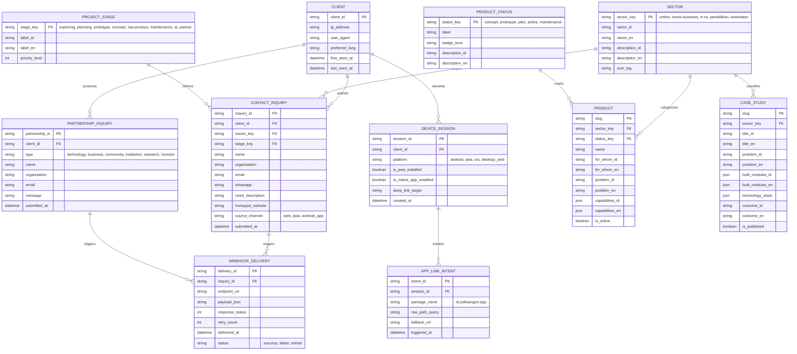
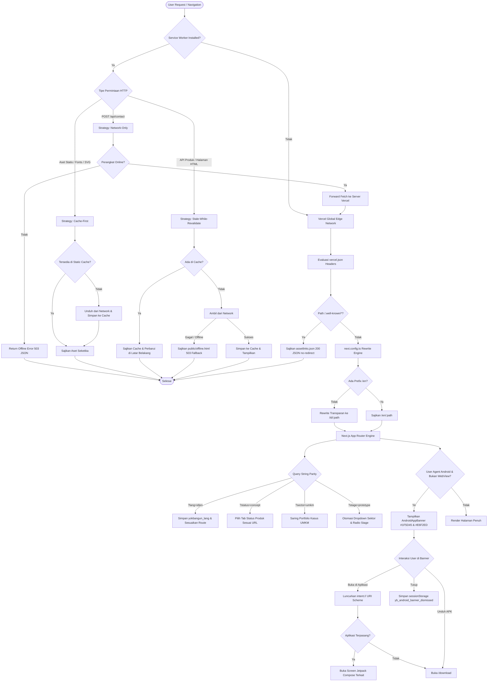
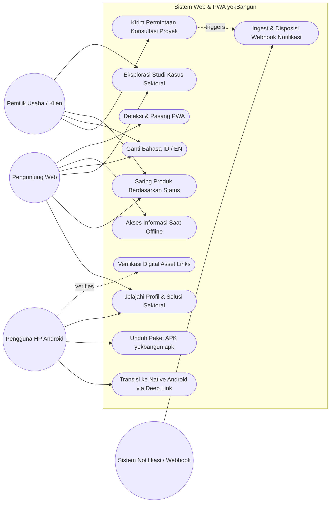
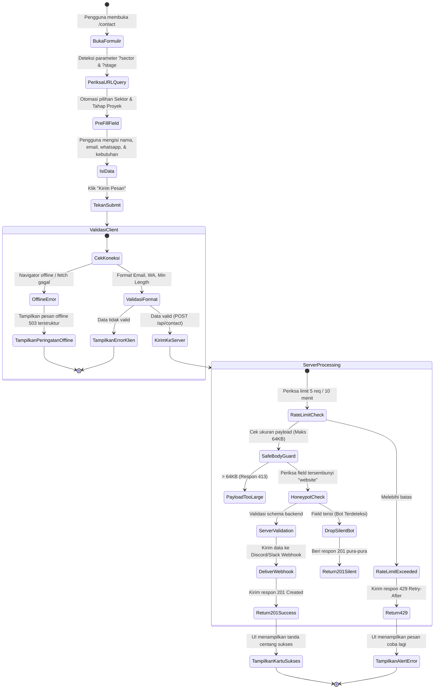
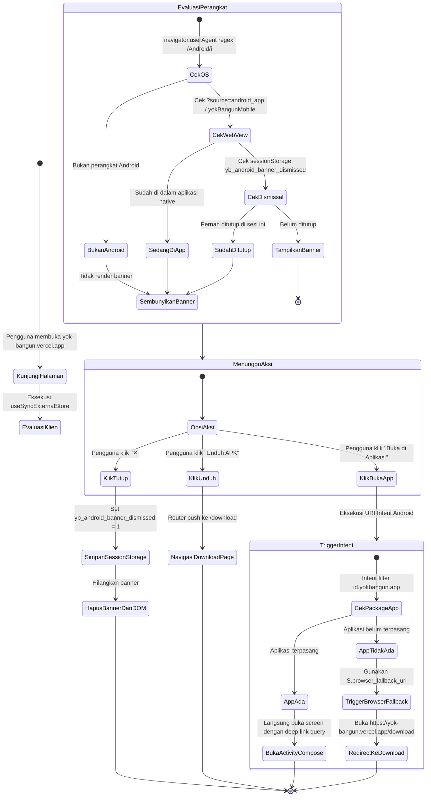
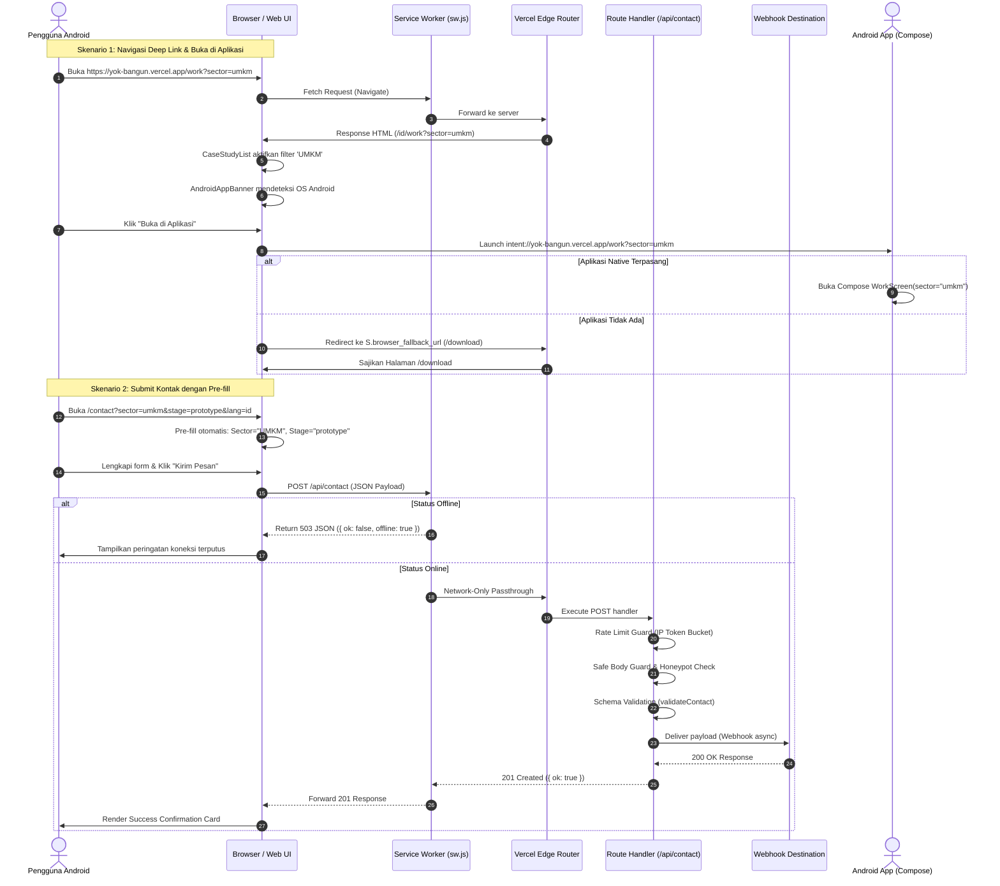

# Dokumentasi Arsitektur Sistem & 5 Unsur Perancangan UML
## Proyek: yokBangun — Solusi Digital & AI (`company-profile`)

Dokumen ini memuat dokumentasi rancang bangun teknis komprehensif sistem **yokBangun**, mencakup **5 Unsur Perancangan Perangkat Lunak**:
1. **ERD (Entity Relationship Diagram)**
2. **LRS (Logical Record Structure)**
3. **LSF (Logical System Flow / Diagram Alir Sistem Logis)**
4. **Use Case Diagram & Spesifikasi Use Case**
5. **Activity Diagram & Pemodelan UML (Class, Sequence, Component, & Deployment Diagram)**

---

## 1. ERD (Entity Relationship Diagram)

ERD menggambarkan pemodelan data konseptual yokBangun yang mencakup entitas bisnis (Klien, Kebutuhan Proyek, Portofolio, Katalog Produk) serta entitas operasional PWA dan integrasi aplikasi Android.



---

## 2. LRS (Logical Record Structure)

LRS merepresentasikan struktur rekaman tabel relasional ternormalisasi (3NF) lengkap dengan *Primary Key* (PK), *Foreign Key* (FK), tipe data, dan konstrain integritas data:

```
┌──────────────────────────────────────────────────────────────┐
│ SECTOR                                                       │
├──────────────────────────────┬───────────────────────────────┤
│ * sector_key (PK)            │ VARCHAR(32)                   │
│   name_id                    │ VARCHAR(80) NOT NULL          │
│   name_en                    │ VARCHAR(80) NOT NULL          │
│   description_id             │ TEXT                          │
│   description_en             │ TEXT                          │
│   icon_tag                   │ VARCHAR(32)                   │
└──────────────────────────────┴───────────────────────────────┘
          │ (1:N)                                │ (1:N)
          ▼                                      ▼
┌──────────────────────────────┐       ┌──────────────────────────────┐
│ PRODUCT                      │       │ CASE_STUDY                   │
├──────────────────────────────┤       ├──────────────────────────────┤
│ * slug (PK)                  │       │ * slug (PK)                  │
│ * sector_key (FK)            │       │ * sector_key (FK)            │
│ * status_key (FK)            │       │   title_id                   │
│   name                       │       │   title_en                   │
│   for_whom_id                │       │   problem_id                 │
│   problem_id                 │       │   problem_en                 │
│   capabilities_json          │       │   technology_stack_json      │
│   is_active                  │       │   built_modules_json         │
└──────────────────────────────┘       │   outcome_id                 │
          ▲                            │   is_published               │
          │ (N:1)                      └──────────────────────────────┘
┌──────────────────────────────┐
│ PRODUCT_STATUS               │
├──────────────────────────────┤
│ * status_key (PK)            │
│   label                      │
│   badge_tone                 │
│   description_id             │
└──────────────────────────────┘

┌──────────────────────────────────────────────────────────────┐
│ CLIENT                                                       │
├──────────────────────────────┬───────────────────────────────┤
│ * client_id (PK)             │ VARCHAR(64)                   │
│   ip_address_hash            │ VARCHAR(64) NOT NULL          │
│   preferred_lang             │ VARCHAR(5) DEFAULT 'id'       │
│   user_agent                 │ VARCHAR(255)                  │
│   first_seen_at              │ TIMESTAMP DEFAULT NOW()       │
│   last_seen_at               │ TIMESTAMP DEFAULT NOW()       │
└──────────────────────────────┴───────────────────────────────┘
          │ (1:N)                                │ (1:N)
          ▼                                      ▼
┌──────────────────────────────┐       ┌──────────────────────────────┐
│ CONTACT_INQUIRY              │       │ DEVICE_SESSION               │
├──────────────────────────────┤       ├──────────────────────────────┤
│ * inquiry_id (PK)            │       │ * session_id (PK)            │
│ * client_id (FK)             │       │ * client_id (FK)             │
│ * sector_key (FK)            │       │   platform                   │
│ * stage_key (FK)             │       │   is_pwa_installed           │
│   name                       │       │   is_native_app_installed    │
│   organisation               │       │   deep_link_target           │
│   email                      │       │   created_at                 │
│   whatsapp                   │       └──────────────────────────────┘
│   need_description           │                         │ (1:N)
│   source_channel             │                         ▼
│   submitted_at               │       ┌──────────────────────────────┐
└──────────────────────────────┘       │ APP_LINK_INTENT              │
          │ (1:N)                      ├──────────────────────────────┤
          ▼                            │ * intent_id (PK)             │
┌──────────────────────────────┐       │ * session_id (FK)            │
│ WEBHOOK_DELIVERY             │       │   package_name               │
├──────────────────────────────┤       │   raw_path_query             │
│ * delivery_id (PK)           │       │   fallback_url               │
│ * inquiry_id (FK)            │       │   triggered_at               │
│   endpoint_url               │       └──────────────────────────────┘
│   payload_json               │
│   response_status            │
│   status                     │
│   delivered_at               │
└──────────────────────────────┘
```

### Karakteristik Normalisasi Data (3NF):
1. **Atribut Atomik**: Seluruh nilai kolom (nama, email terverifikasi regex, status kode) bersifat atomik.
2. **Ketergantungan Fungsional Penuh**: Setiap atribut non-kunci bergantung secara utuh pada *Primary Key* masing-masing tabel.
3. **Bebas Ketergantungan Transitif**: Status kode dipisahkan ke dalam tabel referensi lookup `PRODUCT_STATUS` dan `PROJECT_STAGE`, mencegah anomali pembaruan teks deskripsi status di banyak tempat.

---

## 3. LSF (Logical System Flow / Diagram Alir Sistem Logis)

LSF menggambarkan sirkulasi pemrosesan logika sistem dari saat klien mengirimkan permintaan HTTP, pemrosesan di Vercel Edge Serverless, Service Worker caching, perutean App Links Android, hingga pengiriman webhook aman.



---

## 4. Use Case Diagram & Spesifikasi Use Case

### 4.1. Use Case Diagram (UML)



### 4.2. Spesifikasi Use Case Utama

| ID | Nama Use Case | Aktor | Kondisi Awal (Pre-condition) | Alur Utama (Main Scenario) | Kondisi Akhir (Post-condition) |
| :--- | :--- | :--- | :--- | :--- | :--- |
| **UC-01** | Saring Produk via Deep Link (`?status=...`) | Pengunjung, Pengguna Android | Pengguna mengakses URL beranda atau `/products` dengan parameter `?status=concept` atau `?status=prototype`. | 1. Sistem memeriksa query string `status`.<br>2. Halaman beranda otomatis me-redirect ke `/products?status=concept`.<br>3. Komponen `ProductList` mengaktifkan tab filter yang sesuai tanpa me-reload DOM.<br>4. URL browser terbarui secara instan. | Hanya produk dengan status terpilih yang ditampilkan di layar. |
| **UC-02** | Pre-fill Formulir Kontak (`/contact?sector=...&stage=...`) | Pemilik Usaha / Klien | Pengguna mengklik tautan konsultasi dari halaman sektor atau aplikasi Android. | 1. Sistem mem-parsing `sector` dan `stage` dari URL query.<br>2. Formulir memilih otomatis dropdown Sektor (contoh: "UMKM") dan radio button Stage (contoh: "Tahap Prototype").<br>3. Pengguna melengkapi nama, organisasi, email, whatsapp, dan deskripsi kebutuhan.<br>4. Pengguna menekan tombol submit. | Data terkirim dengan validasi 201 Created dan diteruskan ke webhook. |
| **UC-03** | Transisi ke Native Android via Intent | Pengguna Android | Pengguna menggunakan browser Chrome di smartphone Android membuka situs yokBangun. | 1. Komponen `AndroidAppBanner` mendeteksi OS Android.<br>2. Banner menampilkan CTA *"Buka di Aplikasi"* dan *"Unduh APK"* berpalet `#1F5D45`.<br>3. Pengguna menekan *"Buka di Aplikasi"*.<br>4. Browser meluncurkan URI `intent://yok-bangun.vercel.app/...#Intent;package=id.yokbangun.app;S.browser_fallback_url=...;end`.<br>5. Jika aplikasi terpasang, OS Android membuka Jetpack Compose; jika tidak, dialihkan ke `/download`. | Pengguna berada di native app atau mendarat di panduan download. |
| **UC-04** | Navigasi Offline Fallback | Pengunjung PWA | Koneksi internet terputus saat pengguna membuka halaman baru. | 1. Browser mengirim request navigasi HTML.<br>2. Service Worker mendeteksi koneksi terputus.<br>3. Service Worker menyajikan [public/offline.html](file:///c:/Users/user/Desktop/company-profile/public/offline.html) mandiri.<br>4. Pengguna tetap dapat membaca ringkasan layanan dalam Bahasa Indonesia atau English.<br>5. Formulir kontak menampilkan peringatan proteksi offline. | Pengguna tetap mendapatkan informasi tanpa melihat layar blank browser. |

---

## 5. Activity Diagram & Pemodelan UML

### 5.1. Activity Diagram: Alur Pengiriman Formulir Kontak & Proteksi Offline



### 5.2. Activity Diagram: Alur Transisi Android App Links & Smart Banner



---

### 5.3. UML Class Diagram

Diagram kelas ini memperlihatkan pemisahan tanggung jawab antarmuka, store state klien, API handler, dan komponen presentasi:

```mermaid
classDiagram
    class NextConfig {
        +boolean reactStrictMode
        +boolean compress
        +redirects() Promise~RedirectRule[]~
        +rewrites() Promise~RewriteRule[]~
        +headers() Promise~HeaderRule[]~
    }

    class LanguageStore {
        +Locale language
        +boolean hasChosen
        +setLanguage(Locale language) void
    }

    class LocalePreference {
        +Locale locale
        +useEffect() void
    }

    class AndroidAppBanner {
        +Locale locale
        -boolean isVisible
        +handleDismiss() void
        +render() JSX.Element
    }

    class ProductList {
        +Locale locale
        +Product[] initialData
        -ProductStatus selectedStatus
        +handleSelectStatus(ProductStatus status) void
        +render() JSX.Element
    }

    class CaseStudyList {
        +Locale locale
        +CaseStudy[] initialData
        -string selectedSector
        +handleSelectSector(string sectorKey) void
        +render() JSX.Element
    }

    class ContactForm {
        +Locale locale
        -ContactInput values
        -FieldErrors errors
        -boolean submitted
        +handleChange(string field, string value) void
        +handleSubmit(FormEvent event) void
        +render() JSX.Element
    }

    class ContactSchema {
        +string[] projectStages
        +validateContact(unknown raw) ValidationResult
    }

    class ServiceWorker {
        +string CACHE_VERSION
        +string[] PRECACHE_ASSETS
        +install(Event e) void
        +activate(Event e) void
        +fetch(FetchEvent e) void
        -isStaticAsset(URL url, Request req) boolean
        -isPublicContentApi(URL url) boolean
    }

    class RouteAssetlinks {
        +GET() NextResponse
    }

    class RouteContact {
        +POST(Request req) Promise~NextResponse~
    }

    ContactForm ..> ContactSchema : validates using
    ContactForm ..> RouteContact : submits to
    LocalePreference ..> LanguageStore : reads/syncs with
    AndroidAppBanner ..> NextConfig : deep links follow
    RouteAssetlinks ..> NextConfig : exempted from rewrites
    ProductList ..> LanguageStore : displays localized content
    CaseStudyList ..> LanguageStore : displays localized content
    ServiceWorker ..> RouteContact : applies Network-Only guard
```



---

### 5.4. UML Sequence Diagram: Deep Link Intent & Form Ingestion

Diagram urutan berikut menggambarkan alur interaksi antara Pengguna, Browser, Service Worker, Next.js Serverless API, dan Webhook Target:



---

### 5.5. UML Component Diagram

Diagram komponen menguraikan subsistem modular, dependensi pustaka, dan titik integrasi:

```mermaid
componentDiagram
    package "Client Tier (Browser & PWA)" {
        [React UI Components] as Components
        [Zustand Language Store] as LangStore
        [React Query Cache] as QueryCache
        [Service Worker (sw.js)] as SW
        [Offline Fallback Page] as OfflinePage
    }

    package "Static Assets & PWA Identity" {
        [manifest.webmanifest] as Manifest
        [assetlinks.json] as Assetlinks
        [SVG & PNG App Icons] as Icons
        [yokbangun.apk] as APK
    }

    package "Next.js App Router (Vercel Serverless)" {
        [Rewrites & Headers Engine] as NextConfig
        [Localized Page Routers ([locale])] as PageRouters
        [API Route: /api/contact] as ApiContact
        [API Route: /api/v1/products] as ApiProducts
        [Security Rate Limiter & BodyGuard] as SecurityGuards
    }

    package "Mobile Platform & External Integrations" {
        [Android App (id.yokbangun.app)] as AndroidApp
        [Discord / Slack Webhooks] as WebhookTarget
    }

    Components --> LangStore : Synchronizes language
    Components --> QueryCache : Fetches and caches data
    Components ..> SW : Controlled by
    SW ..> OfflinePage : Serves on navigation offline
    SW ..> Manifest : Precaches
    SW ..> Icons : Caches First

    PageRouters --> NextConfig : Config-level rewrites
    ApiContact --> SecurityGuards : Protected by
    ApiContact --> WebhookTarget : Delivers submissions

    AndroidApp --> Assetlinks : Verifies App Links
    Components --> AndroidApp : Deep links via Intent URI
    PageRouters ..> APK : Serves download link
```

---

### 5.6. UML Deployment Diagram

Diagram *deployment* mengilustrasikan pemetaan fisik infrastruktur komputasi dari perangkat pengguna, Vercel Edge Serverless, hingga server webhook:

```mermaid
deploymentDiagram
    node "User Mobile Device / PC" <<Device>> {
        node "Web Browser (Chrome / Edge / Safari)" <<Browser>> {
            artifact "PWA Shell & Cache Storage"
            artifact "Service Worker Controller"
            artifact "DOM & React Hydration"
        }
        node "Android OS 8.0 - 15" <<Operating System>> {
            artifact "Package: id.yokbangun.app"
            artifact "Android App Links Intent Dispatcher"
        }
    }

    node "Vercel Global Edge Network" <<Cloud Infrastructure>> {
        node "Edge Cache & CDN" <<Reverse Proxy>> {
            artifact "Static Assets (/icons, /download, /manifest.webmanifest)"
            artifact "/.well-known/assetlinks.json"
            artifact "Clean URLs & Header Directives (vercel.json)"
        }
        node "Serverless Compute Region (iad1 / sin1)" <<Node.js Runtime>> {
            artifact "Next.js 16 App Router Engine"
            artifact "Route Handlers (/api/contact, /api/v1/*)"
            artifact "In-Memory Rate Limiting Token Bucket"
        }
    }

    node "External Notification Services" <<Cloud>> {
        node "Webhook Consumer Server" {
            artifact "Slack / Discord / CRM Ingestion Endpoint"
        }
    }

    "Web Browser (Chrome / Edge / Safari)" --> "Edge Cache & CDN" : HTTPS / HTTP/3 (Port 443)
    "Android OS 8.0 - 15" --> "/.well-known/assetlinks.json" : Digital Asset Links Handshake
    "Edge Cache & CDN" --> "Serverless Compute Region (iad1 / sin1)" : Internal Fast Path
    "Serverless Compute Region (iad1 / sin1)" --> "Webhook Consumer Server" : TLS 1.3 Outbound Webhook POST
```

---

Dokumentasi ini telah disinkronkan secara menyeluruh dengan implementasi kode produksi di repositori, konfigurasi perutean Vercel, serta verifikasi Digital Asset Links pada `https://yok-bangun.vercel.app/`.
