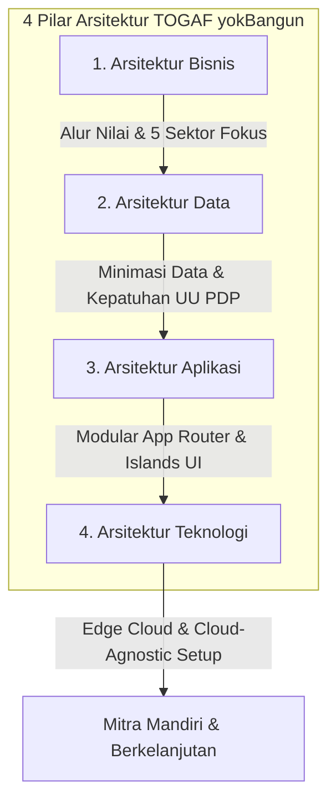

# Architecture Decision Record (ADR)
## ADR-003: Penyelarasan Sistem yokBangun dengan Pilar TOGAF & Siklus ADM
**Status:** Diterima (Accepted)  
**Tanggal:** 2026-10-15  
**Pembuat Keputusan:** Auditor, Perancang, Peninjau & Tim Arsitektur  

---

### Konteks & Latar Belakang
Untuk memastikan pengembangan jangka panjang yang terstruktur dan tidak bergantung pada pengembang individu (*anti-vendor lock-in*), yokBangun menyelaraskan seluruh rancangan dan keputusannya dengan kerangka kerja The Open Group Architecture Framework (TOGAF).

---

### Keputusan Arsitektur: 4 Pilar TOGAF

1. **Arsitektur Bisnis (Business Architecture):**
   - Menjawab kebutuhan operasional 5 sektor fokus: UMKM, Usaha Rumahan, RT/RW (civicGov), Pendidikan, dan Layanan Kesehatan.
   - Mengadopsi alur kerja 6 tahap: **Pahami $\rightarrow$ Tentukan $\rightarrow$ Bangun $\rightarrow$ Luncurkan $\rightarrow$ Rawat $\rightarrow$ Kembangkan**.
2. **Arsitektur Data (Data Architecture):**
   - Prinsip minimasi data: hanya mengumpulkan nama, kontak, dan deskripsi kebutuhan proyek pada formulir.
   - Kepatuhan penuh terhadap UU No. 27 Tahun 2022 tentang Pelindungan Data Pribadi (UU PDP).
   - Tidak ada data pribadi atau rahasia yang disimpan dalam penyimpanan lokal peramban (*localStorage/CacheStorage*).
3. **Arsitektur Aplikasi (Application Architecture):**
   - Pemisahan bersih antara komponen server (*Zero-Bundle SSR*) dan komponen interaktif (*Client Islands*).
   - Ekosistem fitur modular: `features/contact/`, `features/partnership/`, `features/portfolio/`, `features/products/`.
4. **Arsitektur Teknologi (Technology Architecture):**
   - Arsitektur *cloud-agnostic* yang dapat dipindahkan kapan pun dari Vercel ke Cloudflare Workers, VPS mandiri, atau infrastruktur lokal tanpa merombak logika inti.
   - Header keamanan baku: HSTS (2 tahun), CSP, X-Content-Type-Options nosniff, Referrer Policy strict-origin.

---

### Konsekuensi
- **Positif:** Kejelasan batas tanggung jawab modul; migrasi infrastruktur berbiaya rendah; kepatuhan hukum data pribadi terjamin; serah terima proyek ke klien berlangsung transparan.
- **Tantangan:** Setiap penambahan fitur baru wajib dievaluasi melalui matriks kesesuaian 4 pilar TOGAF sebelum disetujui.
